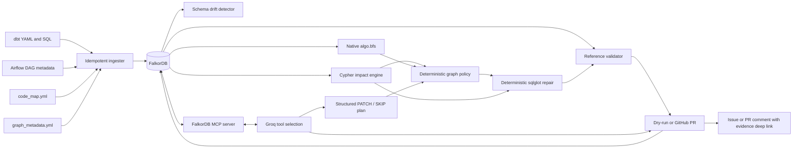

# Architecture and graph model

FalkorDB is the only runtime catalog, lineage, validation, and repair-state store. The
application has no alternate in-memory graph and no metadata-service fallback.

## Node labels

| Label | Stable ID | Important properties |
|---|---|---|
| `Dataset` | `dataset:<qualified-name>` | name, platform, kind, schema_version |
| `Column` | `column:<qualified-dataset>:<column>` | dataset_id, native_type, data_type, ordinal, active, schema_version |
| `DbtModel` | `model:<model-name>` | name |
| `AirflowJob` | `job:<dag-id>.<task-id>` | name, dag_id |
| `CodeAsset`, `SourceFile` | `file:<repository-path>` | path, kind, content_sha256, size_bytes |
| `Incident` | the deterministic drift ID | kind, column, status, updated_at |
| `RepairRun` | the application run ID | status, pr_url, finished_at |

## Relationships

- `(Dataset)-[:HAS_COLUMN]->(Column)` models membership.
- `(Column)-[:FLOWS_TO {operation, alias_boundary}]->(Column)` is column lineage.
- `(DbtModel|AirflowJob)-[:READS]->(Column)` and `-[:WRITES]->(Column)` capture code-level access.
- `(DbtModel)-[:PRODUCES]->(Dataset)` links the executable model to its output.
- `(DbtModel|AirflowJob)-[:DEPENDS_ON]->(...)` captures orchestration dependencies.
- `(CodeAsset)-[:IMPLEMENTS]->(DbtModel|AirflowJob)` maps graph evidence to patchable files.
- `(Incident)-[:AFFECTS]->(Dataset)`, `(RepairRun)-[:HANDLES]->(Incident)`, and
  `(RepairRun)-[:PATCHED]->(...)` persist the review/audit state.

`alias_boundary=true` is set when a lineage edge changes a column's public output name.
An asset is patch-required when the path reaches its read before a previous alias boundary;
assets farther downstream of that boundary are reported as insulated. Skips are also a
graph result: there is no `FLOWS_TO` path and no direct `READS` edge.

## Ingestion contract

`scripts/seed_falkordb.py` combines:

- dbt source/model schemas and descriptions;
- dbt SQL and `code_map.yml` model/file mappings;
- Airflow task metadata parsed from the DAG;
- type, Airflow read, and explicit column-lineage metadata in `graph_metadata.yml`.

All nodes and relationships use `MERGE`; rerunning ingestion is idempotent. `--reset`
deletes only the configured FalkorDB graph and rebuilds it. `--verify` checks node/edge
counts against the parsed input payload.

## Runtime safeguards

The MCP tools are `inspect_schema`, `trace_column_impact`, `explore_lineage_bfs`,
`explain_lineage_path`, `classify_affected_asset`, `assess_repair_candidates`,
`validate_candidate_repair`, and `record_repair_result`. `explore_lineage_bfs` executes
FalkorDB's native `CALL algo.bfs(...)` procedure rather than traversing in application memory.
Calls and structured results are copied to the run timeline.

When configured, Groq obtains tool definitions from the FalkorDB MCP server, dynamically
selects read-only tools, and executes them over an actual stdio JSON-RPC MCP session. It then
submits a structured PATCH/SKIP plan covering every code asset. Deterministic policy checks
that each decision and cited tool agrees with FalkorDB evidence. A verified plan drives the
constrained AST executor; an incomplete or conflicting plan is visibly rejected and the
deterministic fallback takes over. Groq never receives `Patch.after` and cannot write files.
